# Garde-fou (`garde`)

[](https://github.com/ArchiPiXL/garde-fou/actions/workflows/ci.yml)
[](https://github.com/ArchiPiXL/garde-fou/actions/workflows/release.yml)
[](https://github.com/ArchiPiXL/garde-fou/releases/latest)
[](https://github.com/ArchiPiXL/garde-fou/releases)
[](https://www.rust-lang.org/)
[](Cargo.toml)

> [English](README.md) | **Français**

**Garde-fou** est un analyseur statique polyglotte et orchestrateur de gouvernance ultra-strict écrit en Rust sûr (`0 unsafe`, moteur de règles `#![no_std]`). Il unifie l'analyse AST `Tree-sitter`, la ségrégation architecturale en 6 domaines, le scellement anti-contournement (`BLAKE3`) et les vérificateurs `SARIF` 2.1.0 / `LCOV` dans un seul binaire CLI rapide (`garde`).

[](assets/overview.fr.svg)

## Fonctionnement

Garde-fou projette chaque langage supporté dans un AST universel `#![no_std]` (`UAST`) et applique des règles déterministes sur trois niveaux :

- **Tier 1 — AST natif (`GF000`–`GF080`) :** métriques structurelles SRP, détection de clones Type-2, exports morts, cycles DAG Tarjan, KISS/YAGNI/TDD (dont l'arité des tuples anonymes et le dépaquetage global), ségrégation 6 domaines et garde-fous de sécurité natifs sur 23 langages.
- **Tier 2 — Durcissement des configs (`GF081`) :** empêche l'affaiblissement de `pyproject.toml`, `ruff.toml`, `tsconfig.json`, `mutants.toml`, `stryker*.json`, `infection.json5`, `.hadolint.yaml`, `.shellcheckrc`, `phpstan.neon` et des toolchains (`pnpm`/`uv`/Gradle `.kts`).
- **Tier 3 — Écosystème, Mutation & SARIF (`GF041`–`GF082`) :** impose les tests de mutation à 100% (`cargo-mutants`, `Stryker`, `mutmut`, `gremlins`, `PITest`, `Stryker.NET`, `Infection`, `mutation_test`) et ingère `gitleaks`, `osv-scanner`, `ruff`, `mypy`, `oxlint`, `tsc`, `shellcheck`, `hadolint`, `yamllint`, `golangci-lint`, `phpstan` et `dart analyze`.
- **Gouvernance agentique (`GF070`) :** scelle `garde-fou.toml` dans `garde.lock` (`BLAKE3`) et synchronise `AGENTS.md` + `.agents/skills/` via `garde sync`.

[Stack supportée](https://github.com/ArchiPiXL/garde-fou/wiki/Stack-Supportee-FR) · [Six domaines](https://github.com/ArchiPiXL/garde-fou/wiki/Six-Domaines-FR) · [Catalogue des règles (`GF000`–`GF082`)](https://github.com/ArchiPiXL/garde-fou/wiki/Catalogue-Regles-FR)

## Installation

Via `mise` (recommandé) :

```bash
mise use -g github:ArchiPiXL/garde-fou
```

Ou via les installeurs one-liner vérifiés par `SHA256SUMS` :

```bash
# Linux & macOS
curl -fsSL https://github.com/ArchiPiXL/garde-fou/releases/latest/download/install.sh | sh
```

```powershell
# Windows PowerShell 5.1+ / pwsh 7+
irm https://github.com/ArchiPiXL/garde-fou/releases/latest/download/install.ps1 | iex
```

## Démarrage rapide

```bash
garde init                              # Assistant interactif (ou drapeaux --lang/--feature)
garde check --staged --format agent     # Analyse incrémentale rapide (pre-commit & agents IA)
garde check --watch                     # Surveillance temps réel sur sauvegarde
garde tui                               # Poste de pilotage 3 onglets (Diagnostics, Config, Cache)
garde sync                              # Synchronise AGENTS.md, .agents/skills/ et garde.lock
```

## Documentation (Wiki)

- [Langages, Fonctionnalités & Frameworks Supportés](https://github.com/ArchiPiXL/garde-fou/wiki/Stack-Supportee-FR) : 23 `LanguageId`, 14 features, 28 frameworks et 6 archétypes proportionnels
- [Ségrégation Architecturale des 6 Domaines](https://github.com/ArchiPiXL/garde-fou/wiki/Six-Domaines-FR) : `Code`, `Scripts`, `Forme`, `Texte`, `Contenus` et `Asset`
- [Catalogue des Règles (`GF000`–`GF082`)](https://github.com/ArchiPiXL/garde-fou/wiki/Catalogue-Regles-FR) : référence complète avec seuils par défaut
- [Référence CLI & Workflows](https://github.com/ArchiPiXL/garde-fou/wiki/Reference-CLI-FR) : `init`, `check`, `tui`, `config`, `cache`, `sync`, `lock`, `commit-msg`, `uninstall`
- [Architecture Interne](https://github.com/ArchiPiXL/garde-fou/wiki/Architecture-FR) : découpage en 5 crates Functional Core / Imperative Shell
- [Journal des modifications](CHANGELOGS.fr.md) · [AGENTS.md](AGENTS.md)

## Licence

Double licence **MIT** ou **Apache-2.0** (voir [Cargo.toml](Cargo.toml)).
