# Garde-fou (`garde`)

[](https://github.com/ArchiPiXL/garde-fou/actions/workflows/ci.yml)
[](https://github.com/ArchiPiXL/garde-fou/actions/workflows/release.yml)
[](https://github.com/ArchiPiXL/garde-fou/releases/latest)
[](https://github.com/ArchiPiXL/garde-fou/releases)
[](https://www.rust-lang.org/)
[](Cargo.toml)

> **English** | [Français](README.fr.md)

**Garde-fou** is an ultra-strict polyglot static analyzer and governance orchestrator built in Safe Rust (`0 unsafe`, `#![no_std]` rule core). It unifies `Tree-sitter` AST analysis, six-domain architectural segregation, anti-bypass sealing (`BLAKE3`), and external `SARIF` 2.1.0 / `LCOV` verifiers behind a single fast CLI binary (`garde`).

[](assets/overview.svg)

## How it works

Garde-fou compiles every supported language into a single `#![no_std]` Universal AST (`UAST`) and evaluates deterministic rules across three layers:

- **Tier 1 — Native AST (`GF000`–`GF080`):** structural SRP metrics, Type-2 clone detection, dead exports, Tarjan DAG cycles, KISS/YAGNI/TDD checks, six-domain segregation, and native security/idiom rules across 23 languages.
- **Tier 2 — Config hardening (`GF081`):** blocks weakening of `pyproject.toml`, `ruff.toml`, `tsconfig.json`, `.hadolint.yaml`, `.shellcheckrc`, `phpstan.neon`, and toolchains (`pnpm`/`uv`/Gradle `.kts`).
- **Tier 3 — Ecosystem & SARIF (`GF041`–`GF082`):** ingests `gitleaks`, `osv-scanner`, `ruff`, `mypy`, `oxlint`, `tsc`, `shellcheck`, `hadolint`, `yamllint`, `golangci-lint`, `phpstan`, and `dart analyze`.
- **Agentic governance (`GF070`):** seals `garde-fou.toml` in `garde.lock` (`BLAKE3`) and synchronizes `AGENTS.md` + `.agents/skills/` via `garde sync`.

[Supported stack](https://github.com/ArchiPiXL/garde-fou/wiki/Supported-Stack) · [Six domains](https://github.com/ArchiPiXL/garde-fou/wiki/Six-Domains) · [Rule catalog (`GF000`–`GF082`)](https://github.com/ArchiPiXL/garde-fou/wiki/Rule-Catalog)

## Installation

Install via `mise` (recommended):

```bash
mise use -g github:ArchiPiXL/garde-fou
```

Or via verified `SHA256SUMS` one-liners:

```bash
# Linux & macOS
curl -fsSL https://github.com/ArchiPiXL/garde-fou/releases/latest/download/install.sh | sh
```

```powershell
# Windows PowerShell 5.1+ / pwsh 7+
irm https://github.com/ArchiPiXL/garde-fou/releases/latest/download/install.ps1 | iex
```

## Quick start

```bash
garde init                              # Interactive setup wizard (or --lang/--feature flags)
garde check --staged --format agent     # Fast incremental check for pre-commit & AI agents
garde check --watch                     # Real-time watch mode on save
garde tui                               # 3-tab interactive cockpit (Diagnostics, Config, Cache)
garde sync                              # Sync AGENTS.md, .agents/skills/, and garde.lock
```

## Documentation (Wiki)

- [Supported Languages, Features & Frameworks](https://github.com/ArchiPiXL/garde-fou/wiki/Supported-Stack): 23 `LanguageId`, 14 features, 28 frameworks, and 6 proportional archetypes
- [Six-Domain Architectural Segregation](https://github.com/ArchiPiXL/garde-fou/wiki/Six-Domains): `Code`, `Scripts`, `Forme`, `Texte`, `Contenus`, and `Asset`
- [Rule Catalog (`GF000`–`GF082`)](https://github.com/ArchiPiXL/garde-fou/wiki/Rule-Catalog): complete reference with default thresholds
- [CLI & Workflows Reference](https://github.com/ArchiPiXL/garde-fou/wiki/CLI-Reference): `init`, `check`, `tui`, `config`, `cache`, `sync`, `lock`, `commit-msg`, `uninstall`
- [Internal Architecture](https://github.com/ArchiPiXL/garde-fou/wiki/Architecture): 5-crate Functional Core / Imperative Shell boundaries
- [Changelogs](CHANGELOGS.md) · [AGENTS.md](AGENTS.md)

## License

Dual-licensed under **MIT** or **Apache-2.0** (see [Cargo.toml](Cargo.toml)).
